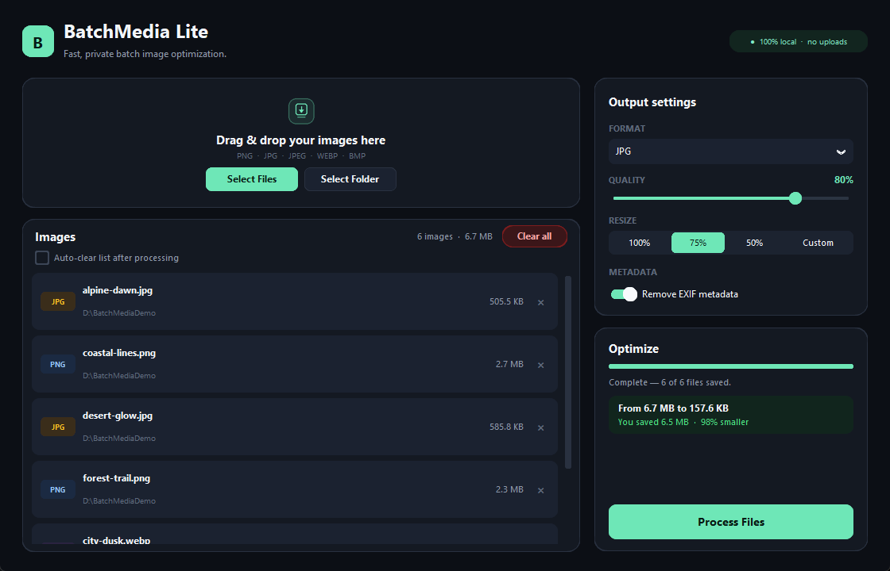
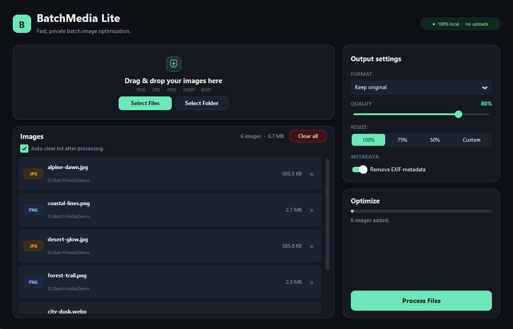

<div align="center">


# BatchMedia Lite

**Shrink a folder of images in seconds — without uploading a single byte.**

A lightweight, offline batch image optimizer for Windows. Drop in your images, pick your settings, and get smaller files in an `optimized` folder beside the originals.

<a href="https://github.com/zuraregan-sys/batchmedia-lite/releases/latest">
  
</a>
&nbsp;
<a href="https://zuraregan.gumroad.com/l/BatchMediaLite">
  
</a>

<br />


<br /><br />



</div>

---

## Why BatchMedia Lite?

Most image optimizers are either online tools that want your files, or heavyweight editors with a dozen settings you never touch. BatchMedia Lite keeps the useful part and removes the rest.

- **Your images stay on your PC.** No accounts, no cloud, no telemetry.
- **Fast enough for folders.** Queue hundreds of images and process them in one go.
- **A real before/after.** See exactly how much space you saved — down to the byte.
- **Nothing gets overwritten.** Results go to an `optimized` subfolder beside your originals.

## Features

| | Feature | What it does |
|:---:|:---|:---|
| 🖱️ | **Drag & drop** | Drop individual images or whole folders into the window. |
| 🗂️ | **Batch queue** | See every file, its format, and its size before you start. |
| 🖼️ | **Format conversion** | Keep the original format, or output JPG, PNG, or WEBP. |
| 🎚️ | **Quality control** | Dial quality from 10–100% for JPG and WEBP. |
| 📐 | **Flexible resizing** | Keep 100%, resize to 75% / 50%, or set a custom max width. |
| 🕵️ | **EXIF removal** | Strip camera, location, and other metadata in one click. |
| 🧹 | **Auto-clear queue** | Keep the savings summary after processing while clearing the list. |
| 🛡️ | **Safe by default** | Skips existing `optimized` folders so images are never re-processed. |
| ⚡ | **Portable EXE** | One file, no installer, no admin rights, no background service. |

## See it in action

<div align="center">

### Build your queue



<br /><br />

### Get a clear result


</div>

## How it works

```text
Your images  ──▶  BatchMedia Lite  ──▶  optimized/  ──▶  Smaller files
                  (all done locally)
```

1. **Add** images or drop in a folder.
2. **Choose** output format, quality, resize, and metadata options.
3. **Process** the batch.
4. **Find** the results in an `optimized` folder next to the originals.

Your original files are never modified.

## Download

Grab the latest portable build from the **[Releases page](https://github.com/zuraregan-sys/batchmedia-lite/releases/latest)**.

1. Download `BatchMediaLite.exe`.
2. Put it anywhere you like.
3. Double-click to launch.

> **Windows SmartScreen note:** This is an independent, unsigned portable app. On first launch Windows may show *“Windows protected your PC.”* Click **More info → Run anyway**. The app runs fully offline.

## Run from source

```bat
git clone https://github.com/zuraregan-sys/batchmedia-lite.git
cd batchmedia-lite
python -m pip install -r requirements.txt
python app.py
```

## Build the portable EXE

Requirements: Windows and Python 3.10+.

```bat
build.bat
```

The script installs the pinned dependencies and creates a single-file, console-free executable at:

```text
dist\BatchMediaLite.exe
```

## Supported formats

| Read | Write |
|:---|:---|
| PNG, JPG, JPEG, WEBP, BMP | Original format, JPG, PNG, WEBP |

## Privacy

BatchMedia Lite makes **no network requests** and contains **no analytics, accounts, or cloud features**. Every image is read, resized, compressed, and saved on your machine.

Metadata removal is optional and uses your chosen setting. The app never sends anything anywhere.

## Built with

- [Python](https://www.python.org/)
- [CustomTkinter](https://github.com/TomSchimansky/CustomTkinter)
- [Pillow](https://python-pillow.org/)
- [tkinterdnd2](https://github.com/Eliav2/tkinterdnd2)
- [PyInstaller](https://pyinstaller.org/)

---

<div align="center">

**Smaller files. Same images. Zero uploads.**

If BatchMedia Lite saves you some disk space, consider giving the repo a ⭐.

</div>
